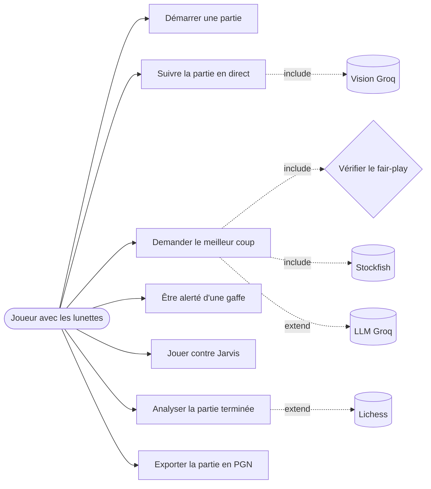
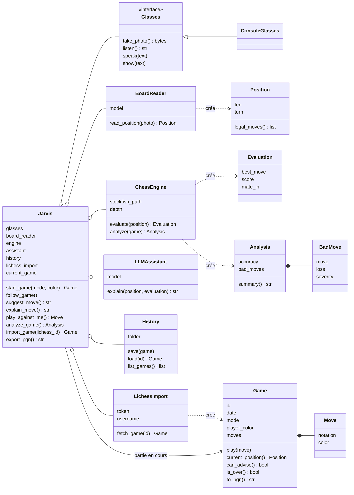
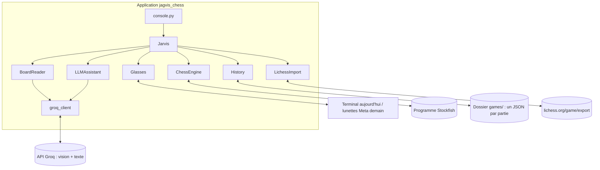
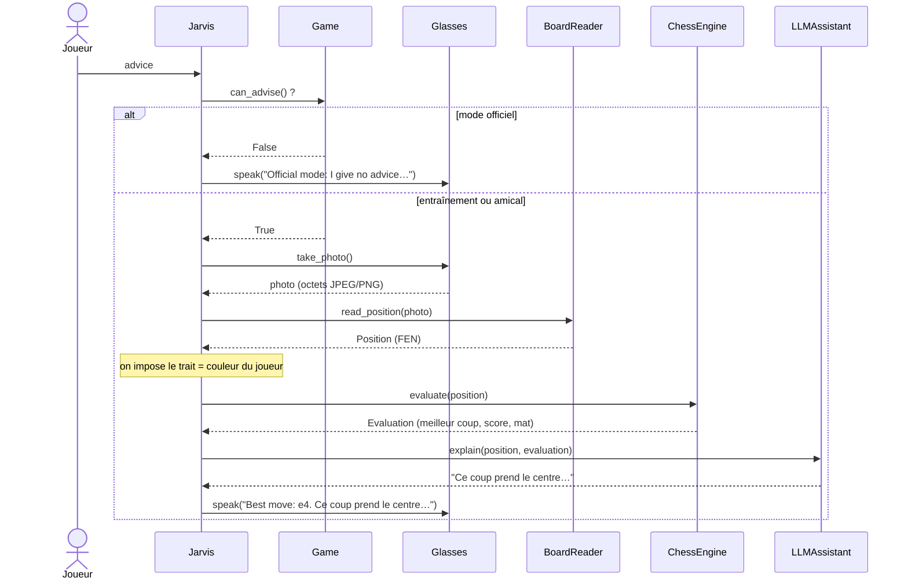
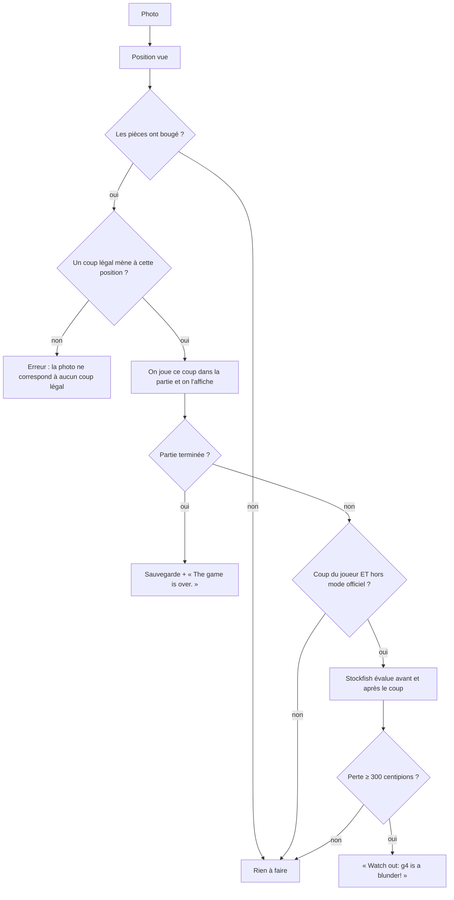
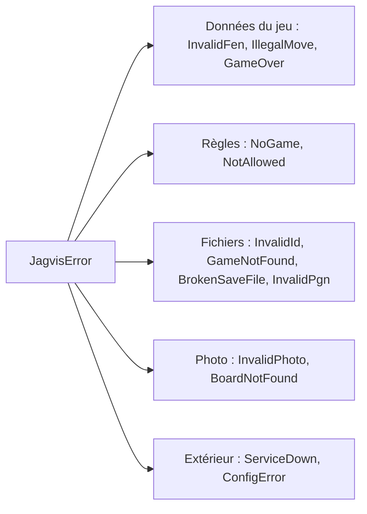
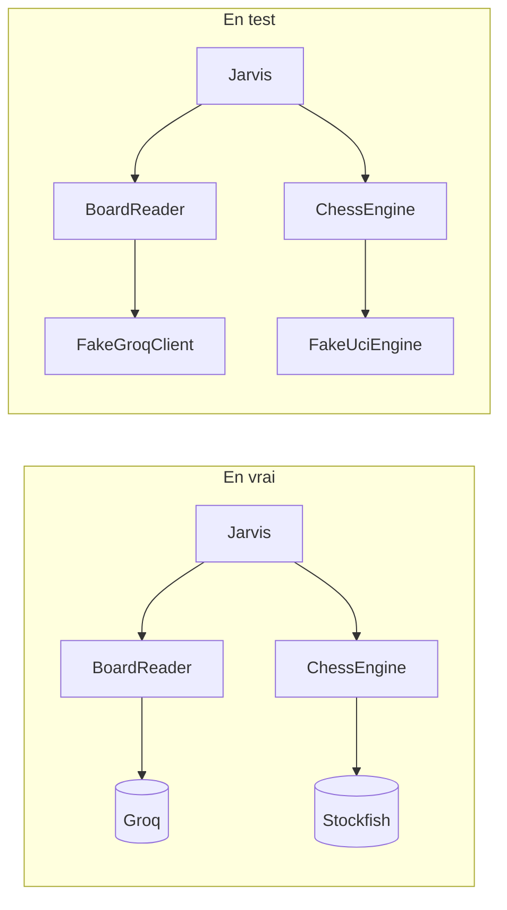

# Jarvis Chess — comment l'application fonctionne

Ce document explique l'application de A à Z, avec des schémas. Il est écrit pour
quelqu'un qui découvre le projet. Les détails du suivi (décisions, commits, tests)
sont dans [`SUIVI.md`](../SUIVI.md).

---

## 1. L'idée

Tu joues aux échecs sur un vrai échiquier avec des **lunettes connectées** sur le
nez. Tu demandes de l'aide, et Jarvis :

1. **prend une photo** de l'échiquier avec les lunettes ;
2. **reconnaît la position** sur la photo (un modèle de vision Groq la traduit en FEN) ;
3. **demande le meilleur coup** au moteur d'échecs **Stockfish** ;
4. **fait expliquer ce coup** par un LLM (Groq), en deux phrases simples ;
5. **le dit à voix haute** dans les lunettes.

Jarvis peut aussi suivre toute la partie, te prévenir quand tu fais une gaffe,
analyser la partie à la fin, importer une partie jouée sur Lichess et l'exporter
en PGN.

> **La règle d'or : le fair-play.** En mode **officiel** (tournoi, partie classée),
> Jarvis ne donne aucun conseil et aucune alerte. Il ne prend même pas de photo pour
> conseiller. Il se contente de noter les coups, et l'analyse arrive après la partie.
> Utiliser un moteur pendant une partie officielle, c'est tricher.

### Petit lexique

| Mot | Sens |
|---|---|
| **FEN** | Une ligne de texte qui décrit une position : `rnbqkbnr/pppppppp/8/8/4P3/8/PPPP1PPP/RNBQKBNR b KQkq - 0 1` |
| **SAN** | La notation habituelle d'un coup : `e4`, `Nf3` (cavalier en f3), `O-O` (petit roque), `Qh4#` (dame en h4, mat) |
| **PGN** | Le format texte standard d'une partie complète (en-têtes + liste des coups) |
| **Centipion** | L'unité du moteur : 100 centipions valent environ un pion d'avance |
| **Stockfish** | Le moteur d'échecs gratuit le plus fort du monde, un programme lancé sur l'ordinateur |
| **Groq** | Un service en ligne qui fait tourner des LLM très vite ; on l'appelle avec la clé `GROQ_KEY` |

---

## 2. Les cas d'utilisation (ce que le joueur peut faire)

D'après `docs/diagrams/use_case_diagram.puml` :

| Cas d'utilisation | Méthode de `Jarvis` | Commande dans la console |
|---|---|---|
| Démarrer une partie (choisir le mode) | `start_game(mode, color)` | `new friendly white` |
| Suivre la partie en direct | `follow_game()` | `follow` |
| Demander le meilleur coup | `suggest_move()` | `advice` |
| Être alerté d'une gaffe | dans `follow_game()` | (automatique) |
| Expliquer le dernier coup | `explain_move()` | `explain` |
| Jouer contre Jarvis | `play_against_me()` | `play` |
| Analyser la partie terminée | `analyze_game()` | `analyze` |
| Importer une partie Lichess | `import_game(lichess_id)` | `import AbCd1234` |
| Exporter la partie (PGN) | `export_pgn()` | `pgn` |

Les **trois modes** de jeu :

| Mode | Conseils | Alertes de gaffe | Jarvis joue contre toi | Analyse |
|---|---|---|---|---|
| `TRAINING` (entraînement) | oui | oui | oui | à tout moment |
| `FRIENDLY` (amical) | oui | oui | oui | à tout moment |
| `OFFICIAL` (officiel) | **non** | **non** | **non** | **seulement à la fin** |

---

## 3. Le schéma de l'application (les classes)

C'est le diagramme du prof (`docs/diagrams/class_diagram.puml`), avec les noms
anglais du code :

On peut ranger les classes en **trois familles** :

| Famille | Classes | Rôle | Fichier |
|---|---|---|---|
| **Le chef d'orchestre** | `Jarvis` | Reçoit les demandes et fait travailler les outils dans le bon ordre | `jarvis.py` |
| **Les outils** | `Glasses`, `BoardReader`, `ChessEngine`, `LLMAssistant`, `LichessImport`, `History` | Chacun fait **une seule chose** et parle à **un seul** monde extérieur | un fichier chacun |
| **Les données** | `Game`, `Position`, `Move`, `GameMode`, `Color` | Le jeu lui-même et ses règles (python-chess fait le gros du travail) | `model.py` |
| | `Evaluation`, `Analysis`, `BadMove`, `Severity` | Ce que renvoie le moteur | `results.py` |

Et deux fichiers d'aide : `errors.py` (toutes les erreurs prévues) et
`groq_client.py` (l'appel à Groq, partagé par `BoardReader` et `LLMAssistant`).

---

## 4. Qui parle à qui (le monde extérieur)

Chaque flèche vers l'extérieur peut tomber en panne. C'est pour ça que chaque outil
transforme les pannes en **erreurs claires** (voir §7).

---

## 5. Le déroulé d'une demande de conseil, pas à pas

C'est le cœur de l'application : `suggest_move()`.

Trois détails importants :

- **Le fair-play passe en premier.** En mode officiel, il n'y a ni photo, ni appel à
  Groq, ni appel à Stockfish.
- **La photo ne dit pas qui doit jouer.** Jarvis impose donc le trait au camp du
  joueur, puisque c'est lui qui demande un conseil.
- **Si le LLM est en panne**, Jarvis dit quand même le coup (`Best move: e4.`).
  L'explication est un bonus.

---

## 6. Les autres déroulés

### Suivre la partie et alerter en cas de gaffe (`follow_game`)

Pour trouver le coup joué, Jarvis essaie **tous les coups légaux** depuis la position
connue et garde celui qui donne exactement les pièces vues sur la photo.

### Analyser une partie (`analyze_game`)

1. Stockfish est lancé **une seule fois**, puis évalue chaque position de la partie.
2. Pour chaque coup **du joueur** : perte = score avant − score après, vu par le
   joueur, avec des scores **plafonnés à ±1000** (quand on gagne déjà largement,
   perdre un peu ne compte pas).
3. La perte donne la **gravité** du coup :

   | Perte | Gravité |
   |---|---|
   | moins de 50 | aucune (bon coup) |
   | 50 à 99 | `INACCURACY` (imprécision) |
   | 100 à 299 | `MISTAKE` (erreur) |
   | 300 et plus | `BLUNDER` (gaffe) |

4. **La précision** suit la formule de Lichess : chaque coup reçoit une note de 0 à
   100 selon la baisse de tes chances de gagner, puis on fait la moyenne.
5. La partie est sauvegardée, et Jarvis annonce le résumé :
   `Accuracy: 55 %. Blunders: 1, mistakes: 0, inaccuracies: 0.`

### Importer une partie Lichess (`import_game`)

`AbCd1234` → vérification de l'identifiant (avant tout appel réseau) →
`GET https://lichess.org/game/export/AbCd1234` → lecture du PGN → `Game`. La partie
est `OFFICIAL` si elle était classée (« Rated »), `FRIENDLY` sinon. Ton camp est
trouvé avec `LICHESS_USERNAME`. La partie est sauvegardée et devient la partie en
cours, prête pour `analyze`.

---

## 7. Les garde-fous

Toutes les erreurs prévues héritent de **`JagvisError`**. La console n'a donc qu'une
seule erreur à attraper : elle dit `Error: <message>` au joueur et continue, sans
jamais afficher de trace Python.

Quelques exemples :

- une photo vide, qui n'est ni JPEG ni PNG, ou qui fait plus de 3 Mo, est refusée
  **avant** tout envoi à Groq ;
- un identifiant comme `../secret` est refusé : il ne peut pas sortir du dossier
  `games/` ;
- Stockfish est **toujours fermé**, même quand il plante ;
- un fichier de sauvegarde abîmé n'empêche pas de voir les autres parties ;
- sans `GROQ_KEY`, la console s'arrête avec un message clair et le code 2.

La liste complète, avec le test qui vérifie chaque cas, est dans `SUIVI.md` §6.

---

## 8. Comment on teste sans Internet ni Stockfish

**Idée clé : l'injection de dépendances.** Une classe ne fabrique pas elle-même ce
qui est lent, payant ou extérieur : elle le **reçoit**. Dans les tests, on lui donne
une **fausse version** écrite à la main (`tests/fakes.py`).

Les tests sont organisés en trois niveaux (comme dans le TP du prof) :

| Niveau | Où | Ce qu'on vérifie |
|---|---|---|
| **Unitaire** | `tests/unit/` | Une classe seule, avec de fausses versions de tout le reste |
| **Acceptation** | `tests/functional/test_acceptance.py` | Les vraies classes assemblées ; seuls Groq, Stockfish et les lunettes sont faux |
| **Bout en bout** | `tests/functional/test_cli.py` | On lance vraiment `python -m jagvis_chess.console` dans un autre processus |

Les tests qui utilisent le **vrai** Stockfish ou le **vrai** Groq sont marqués
(`@pytest.mark.stockfish`, `@pytest.mark.groq`). Ils sont exclus par défaut, et
sautés si l'outil ou la clé manque. On n'y vérifie jamais les mots du LLM,
seulement qu'il a répondu : un LLM ne répond jamais deux fois pareil.

Le projet a été construit en **TDD**, avec un commit à chaque étape :
**red** (un test qui échoue) → **green** (le code minimal qui le fait passer) →
**refactor** (on nettoie sans changer le comportement).

Résultat : **201 tests**, **100 %** du code couvert.

---

## 9. Ce qu'on a fait, dans l'ordre

| Étape | Résumé |
|---|---|
| 1 | Réparation de Git après le renommage du dossier (`git worktree repair`), renommage du dépôt GitHub en **Jagvis** |
| 2 | Construction de Jarvis Échecs en TDD à partir du diagramme du prof, avec les recommandations du TP : tests d'acceptation d'abord, fausses versions écrites à la main, erreurs typées |
| 3 | Code traduit en anglais simple ; choix définitifs : fair-play vérifié en premier, précision façon Lichess, scores plafonnés, camp trouvé avec le pseudo Lichess, roques devinés depuis la photo |
| 4 | Dossier réservé au projet chess : appli de conversation retirée (elle reste sur `main`), diagrammes rangés dans `docs/diagrams/` |
| 5 | Code simplifié et « humanisé » (moins de commentaires, tous en français), ce document, envoi sur GitHub |

---

## 10. Et après ?

- **De vraies lunettes** : écrire une sous-classe de `Glasses` avec le SDK Meta.
  Rien d'autre ne change, c'est tout l'intérêt de l'interface.
- **Installer Stockfish** (`brew install stockfish`) pour jouer pour de vrai et
  lancer `pytest -m stockfish`.
- **Une vraie photo** dans `tests/photos/start.jpg` pour tester le modèle de vision
  (`pytest -m groq`).
- **L'intégration continue** (bonus du TP) : GitHub Actions qui lance les tests à
  chaque push.
