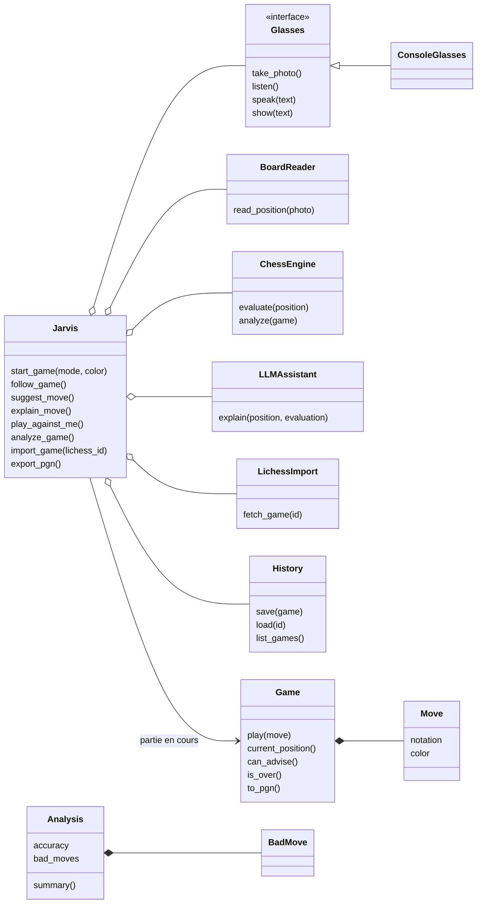
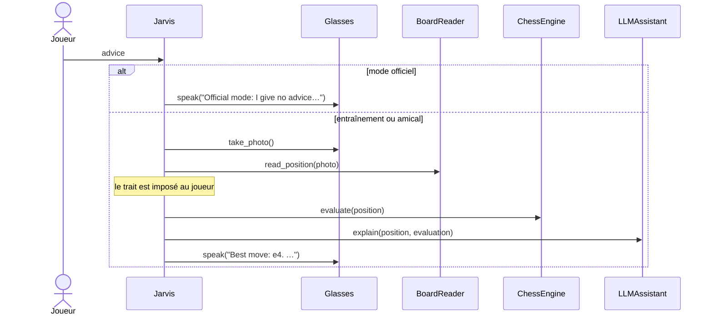

# Comment marche Jarvis Chess

## 1. L'idée en 30 secondes

Tu joues sur un vrai échiquier avec des lunettes connectées. Quand tu demandes
un conseil, Jarvis :

1. prend une **photo** de l'échiquier ;
2. la fait lire par un **modèle de vision** (Groq), qui renvoie la position en FEN ;
3. demande le **meilleur coup** à **Stockfish** ;
4. le fait **expliquer** par un **LLM** (Groq) en deux phrases ;
5. le **dit à voix haute**.

Il sait aussi suivre la partie coup par coup, prévenir d'une gaffe, analyser la
partie, importer une partie Lichess et l'exporter en PGN.

**Règle fair-play** : en mode officiel, aucune aide pendant la partie. Pas de
conseil, pas d'alerte, et même pas de photo pour conseiller. L'analyse vient après.

| Mode | Conseils et alertes | Jarvis joue contre toi | Analyse |
|---|---|---|---|
| `TRAINING` | oui | oui | quand tu veux |
| `FRIENDLY` | oui | oui | quand tu veux |
| `OFFICIAL` | **non** | **non** | **après la partie** |

Petit lexique : **FEN** = une position en une ligne de texte. **SAN** = la notation
d'un coup (`e4`, `Nf3`, `O-O`, `Qh4#`). **PGN** = une partie complète en texte.
**Centipion** = l'unité de Stockfish (100 ≈ un pion d'avance).

---

## 2. Les classes

Le diagramme du prof est dans `docs/diagrams/class_diagram.puml`. Le code reprend
les mêmes classes avec des noms anglais (la correspondance est dans `SUIVI.md` §3).

Trois familles :

- **Le chef d'orchestre** : `Jarvis` (`jarvis.py`). Il reçoit les demandes et fait
  travailler les outils dans le bon ordre.
- **Les outils**, un par fichier, chacun relié à un seul service extérieur :
  `Glasses` (lunettes), `BoardReader` (vision Groq), `ChessEngine` (Stockfish),
  `LLMAssistant` (LLM Groq), `LichessImport` (lichess.org), `History` (fichiers JSON).
- **Les données** : `Game`, `Position`, `Move` (`model.py`), et `Evaluation`,
  `Analysis`, `BadMove` (`results.py`). python-chess s'occupe des règles du jeu.

Fichiers d'aide : `errors.py` (toutes les erreurs), `groq_client.py` (appel à Groq,
partagé par la vision et le LLM), `console.py` (le terminal).

---

## 3. Le parcours d'un conseil (`suggest_move`)

À retenir :
- le fair-play est vérifié **en premier** : en officiel, rien n'est envoyé à Groq ni à Stockfish ;
- une photo ne dit pas qui doit jouer, donc Jarvis met le trait au joueur, puisque c'est lui qui demande ;
- si le LLM est en panne, Jarvis donne quand même le coup (`Best move: e4.`).

---

## 4. Les autres parcours

**Suivre la partie (`follow_game`)** : photo → Jarvis essaie tous les coups légaux et
garde celui qui donne exactement les pièces de la photo → il note le coup. Si c'est
ton coup, hors mode officiel, il compare l'évaluation avant et après, et dit
`Watch out: g4 is a blunder!` si tu as perdu 300 centipions ou plus. À la fin de la
partie, il la sauvegarde.

**Analyser (`analyze_game`)** : Stockfish est lancé une fois et évalue chaque
position. Pour chacun de tes coups :

| Perte (centipions) | Gravité |
|---|---|
| moins de 50 | bon coup |
| 50 à 99 | imprécision |
| 100 à 299 | erreur |
| 300 et plus | gaffe |

Les scores sont **plafonnés à ±1000** : passer de +20 à +15 quand on gagne déjà
n'est pas une gaffe. La **précision** suit la formule de Lichess : chaque coup a une
note de 0 à 100 selon la baisse de tes chances de gagner, puis on fait la moyenne.

**Importer (`import_game`)** : l'id est vérifié avant tout appel réseau, puis le PGN
est téléchargé sur `lichess.org/game/export/{id}`. Une partie classée devient
`OFFICIAL`, sinon `FRIENDLY`. Ton camp est trouvé avec `LICHESS_USERNAME`.

**Autres** : `explain_move` explique le dernier coup joué (refusé en officiel tant
que la partie n'est pas finie). `play_against_me` fait jouer Stockfish pour
l'adversaire (refusé en officiel). `export_pgn` affiche la partie en PGN.

---

## 5. Les garde-fous

Toutes les erreurs prévues héritent de `JagvisError`. La console les attrape, dit
`Error: <message>` et continue, sans afficher de trace Python.

- **Photo** : vide, ni JPEG ni PNG, ou plus de 3 Mo → refusée avant l'envoi à Groq
  (Groq accepte 4 Mo en base64, soit environ 3 Mo de photo).
- **Lecture de la photo** : pas de FEN trouvée, position impossible, ou aucun coup
  légal qui y mène → message clair.
- **Stockfish** : absent ou planté → `ServiceDown`. Il est toujours fermé, même en cas d'erreur.
- **Groq / Lichess** : panne, quota, 404, délai dépassé → message clair.
- **Fichiers** : un id comme `../secret` est refusé ; un fichier abîmé ne bloque pas
  les autres parties.
- **Clé manquante** : sans `GROQ_KEY`, la console s'arrête proprement (code 2).
- **Règles** : pas de partie en cours, pas ton tour, mode officiel → refus expliqué.

---

## 6. Les tests

Chaque classe **reçoit** ce qui est lent, payant ou extérieur (c'est l'injection
de dépendances). Dans les tests, on lui donne une fausse version écrite à la main
(`tests/fakes.py`). Résultat : les tests tournent en moins d'une seconde, sans
Internet ni Stockfish.

| Niveau | Où | Ce qu'on vérifie |
|---|---|---|
| Unitaire | `tests/unit/` | une classe seule |
| Acceptation | `tests/functional/test_acceptance.py` | les vraies classes ensemble ; seuls Groq, Stockfish et les lunettes sont faux |
| Bout en bout | `tests/functional/test_cli.py` | on lance vraiment la console |

Les tests avec le vrai Stockfish ou le vrai Groq sont marqués et exclus par
défaut. On n'y vérifie jamais les mots du LLM, seulement qu'il a répondu.

Le projet a été construit en **TDD** : un test rouge, le code minimal pour le passer
au vert, puis un nettoyage, avec un commit à chaque étape.

**Résultat : 201 tests, 100 % du code couvert.**
